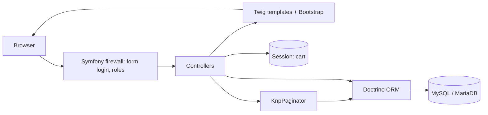
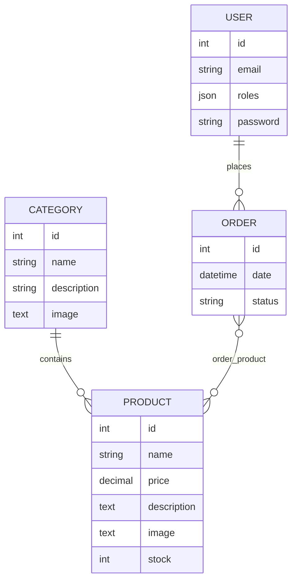
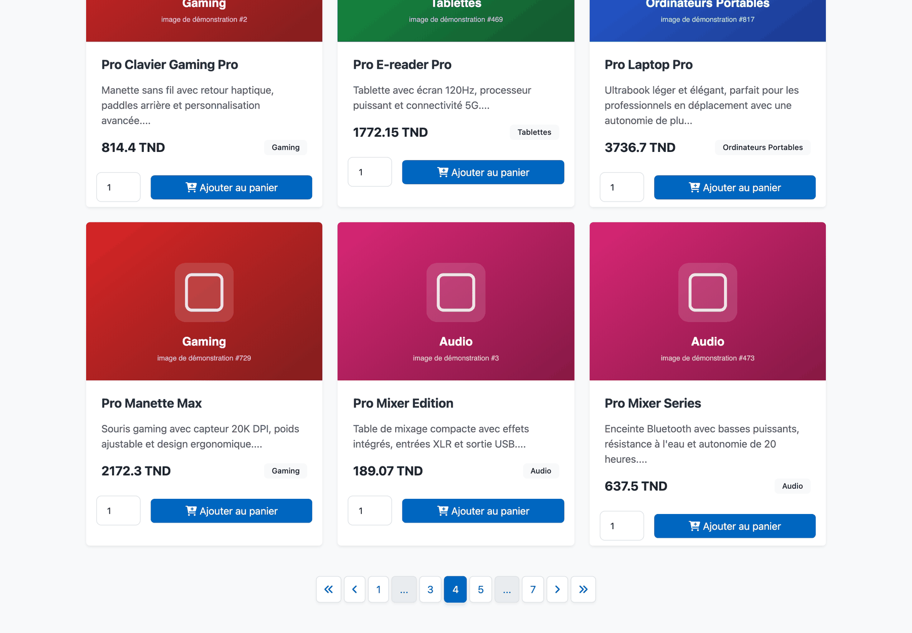
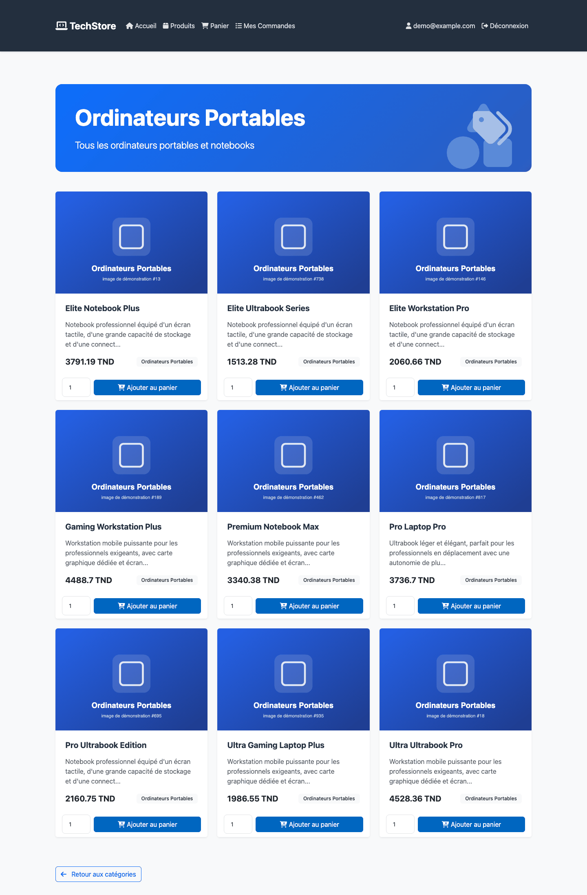
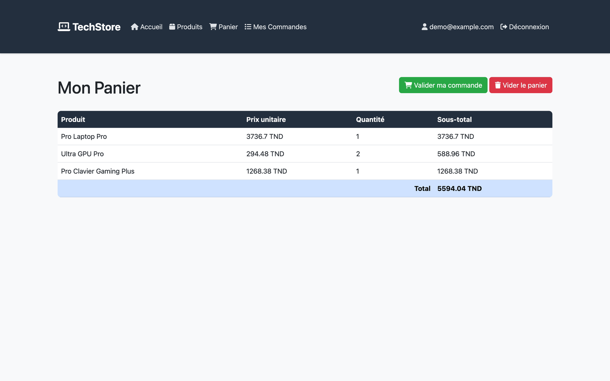
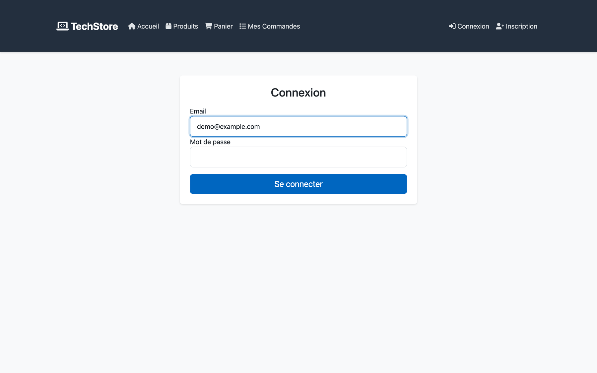
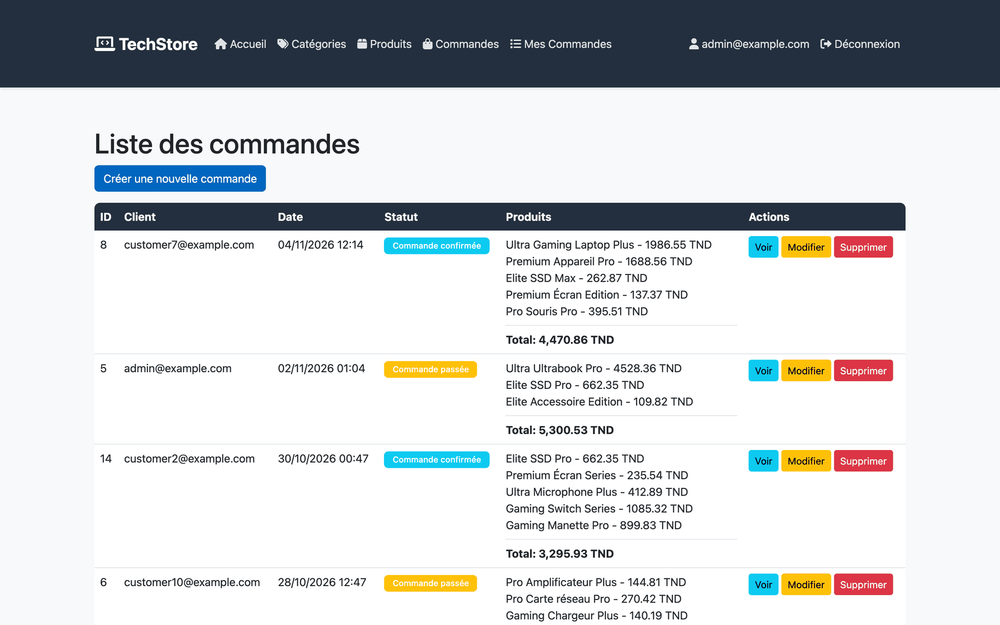

<div align="center">


# TechStore

### A small online shop for tech products, built with Symfony

A server-rendered Symfony 7.2 store with a product catalog, a session cart, orders and an admin area,<br>
backed by Doctrine and MySQL/MariaDB. The interface is in French and prices are in Tunisian dinars (TND).


[How it works](#how-it-works) &nbsp;·&nbsp; [Features](#features) &nbsp;·&nbsp; [Screenshots](#screenshots) &nbsp;·&nbsp; [Get started](#get-started) &nbsp;·&nbsp; [Reference](#reference)

</div>

---

## What is TechStore?

**Why.** A web shop is a good way to practise the parts of a full-stack framework that every real application needs:
user accounts, roles, a relational data model, forms with validation, sessions and paginated lists. TechStore puts
those pieces together in one Symfony project.

**What.** Visitors browse ten tech categories (laptops, smartphones, PC parts, audio and more) and a paginated product
list. Signed-in customers add products to a cart, turn the cart into an order and follow their orders. Administrators
get extra menu entries to create, edit and delete categories, products and orders, and to change an order's status.

**Result.** A working store that runs on `php bin/console` and `symfony server:start`. The demo data (10 categories,
5 to 10 products each, 20 orders, an admin and 10 customers) comes from a Doctrine fixture.

<p align="center">
  
</p>

<sub>Home page for a signed-in customer: welcome banner, category cards, and below them a paginated list of all products. Product and category images in all screenshots are generated placeholders (the fixtures point to random photos on picsum.photos).</sub>

## Features

| Area | What it does | Who |
|---|---|---|
| Accounts | Register with email and a repeated password, sign in with a CSRF-protected form, sign out | Everyone |
| Catalog | Home page and `/product/` list all products sorted by name, 12 per page, with "Stock limité" (5 or fewer) and "Rupture de stock" (0) badges | Everyone |
| Categories | Category cards on the home page; each category page lists its products, 12 per page | Everyone |
| Product page | Name, price, description, category and an "add to cart" form with a quantity field | Everyone (cart needs sign-in) |
| Cart | Stored in the session as product id and quantity. Adding works without a page reload (AJAX plus a toast). Shows line subtotals and a total | Signed-in users |
| Checkout | "Valider ma commande" turns the cart into an order with the status *Commande passée*, empties the cart and opens the order page | Signed-in users |
| My orders | `/user/orders` lists the user's own orders, newest first, 10 per page | Signed-in users |
| Admin | Menu entries for categories and orders; create, edit and delete categories, products and orders; set an order's user, date, products and status (*passée*, *confirmée*, *livrée*) | `ROLE_ADMIN` |
| Pagination | KnpPaginatorBundle with a custom Bootstrap template (first, previous, numbered pages with gaps, next, last) | Everyone |

## How it works

<!-- diagram:request -->

<!-- /diagram -->

<sub>Firewall = Symfony's security layer that checks who is signed in and which role they have; Twig = Symfony's template language; Doctrine ORM = the library that maps PHP classes to database tables; KnpPaginator = a bundle that splits a database query into pages.</sub>

1. **Sign-in.** The `main` firewall uses form login on `/login` with the user's email as the identifier. New accounts get `ROLE_USER`; the fixture admin has `ROLE_ADMIN`.
2. **Browsing.** `HomeController`, `ProductController` and `CategoryController` build a Doctrine query (sorted by name) and hand it to KnpPaginator, 12 products per page.
3. **Cart.** `CartController` keeps an array of `product id => quantity` in the session. The add-to-cart forms are submitted with `fetch` and answered with JSON, so the page shows a toast instead of reloading.
4. **Checkout.** `/cart/validate` creates an `Order` for the current user with the current date and the status *Commande passée*, links the cart's products to it, saves it and clears the cart.
5. **Admin.** Admin-only controller actions are guarded with `#[IsGranted('ROLE_ADMIN')]`, and the navigation shows the categories and orders menus only to admins.

<!-- diagram:data-model -->

<!-- /diagram -->

<sub>An order and its products are linked through the `order_product` join table (many-to-many). Images are stored as URLs, not uploaded files.</sub>

**Tech stack:** PHP 8.2+, Symfony 7.2 (security, forms, validator, Twig), Doctrine ORM 3.3 with Doctrine Migrations, MySQL or
MariaDB, KnpPaginatorBundle 6, Bootstrap 5.3 and Font Awesome 6 from a CDN with a custom stylesheet in `public/css/custom.css`,
and DoctrineFixturesBundle with Faker for demo data. Symfony AssetMapper, Stimulus and Turbo are installed but the base template does not load them.

## Screenshots

<table>
  <tr>
    <td width="50%"></td>
    <td width="50%"></td>
  </tr>
  <tr>
    <td><sub><b>Catalog with pagination.</b> Page 4 of 7 of the product list, 12 products per page.</sub></td>
    <td><sub><b>Category page.</b> The products of one category, here "Ordinateurs Portables".</sub></td>
  </tr>
  <tr>
    <td></td>
    <td></td>
  </tr>
  <tr>
    <td><sub><b>Product page.</b> Details and the add-to-cart form.</sub></td>
    <td><sub><b>Cart.</b> Unit price, quantity and subtotal per line, the total, and the buttons to place the order or empty the cart.</sub></td>
  </tr>
  <tr>
    <td></td>
    <td></td>
  </tr>
  <tr>
    <td><sub><b>Sign-in.</b> Email and password; registration is one click away in the menu.</sub></td>
    <td><sub><b>Admin: orders.</b> Every order with its customer, status, products and total, plus view, edit and delete.</sub></td>
  </tr>
</table>

## Get started

Requirements: PHP 8.2 or higher, Composer, MySQL or MariaDB, and the Symfony CLI (optional but recommended).

```sh
git clone https://github.com/Malekhalifa/e-commerce-symfony.git
cd e-commerce-symfony
composer install
cp .env .env.local                      # set DATABASE_URL to your MySQL/MariaDB server
php bin/console doctrine:database:create
php bin/console doctrine:migrations:migrate
php bin/console doctrine:fixtures:load  # optional demo data
symfony server:start
```

With the fixtures loaded, sign in as **admin@example.com / admin123** for the admin menus. The ten customer accounts have
random Faker emails and the password `password123`; you can also register a new account at `/register`.

```text
src/Controller/        home, product, category, cart, order, user orders, registration, login
src/Entity/            Category, Product, Order, User (Doctrine attributes)
src/Form/              forms for categories, products, orders and registration
src/Repository/        Doctrine repositories
src/DataFixtures/      AppFixtures: demo categories, products, users and orders
templates/             Twig pages, one folder per controller, plus the pagination template
public/css/custom.css  the site's own styles on top of Bootstrap
config/                bundles, security, Doctrine and paginator settings
migrations/            MySQL migrations for the schema
```

## Reference

<details>
<summary><b>Routes</b></summary>

| Path | Method | Name | Access |
|---|---|---|---|
| `/` | any | `app_home` | everyone |
| `/product/` | GET | `app_product_index` | everyone |
| `/product/{id}` | GET | `app_product_show` | everyone |
| `/product/new`, `/product/{id}/edit` | GET, POST | `app_product_new`, `app_product_edit` | admin |
| `/product/{id}` | POST | `app_product_delete` | admin (CSRF token) |
| `/category/` | GET | `app_category_index` | everyone (menu link for admins) |
| `/category/{id}` | GET | `app_category_show` | everyone |
| `/category/new`, `/category/{id}/edit` | GET, POST | `app_category_new`, `app_category_edit` | see limitations |
| `/category/{id}` | POST | `app_category_delete` | see limitations (CSRF token) |
| `/cart/` | GET | `app_cart_index` | signed in |
| `/cart/add/{id}` | POST | `app_cart_add` | signed in; JSON reply when `X-Requested-With: XMLHttpRequest` |
| `/cart/validate` | GET | `app_cart_validate` | signed in |
| `/cart/clear` | GET | `app_cart_clear` | signed in |
| `/order/` | GET | `app_order_index` | admin, 10 per page |
| `/order/new`, `/order/{id}/edit` | GET, POST | `app_order_new`, `app_order_edit` | admin |
| `/order/{id}` | GET | `app_order_show` | admin or the order's owner |
| `/order/{id}` | POST | `app_order_delete` | admin (CSRF token) |
| `/user/orders` | any | `app_user_orders` | signed in, 10 per page |
| `/register`, `/login`, `/logout` | any | `app_register`, `app_login`, `app_logout` | everyone |

`config/packages/security.yaml` also requires `ROLE_ADMIN` for `^/admin` and `ROLE_USER` for `^/cart`. There is no `/admin` route; the admin screens are the role-gated pages above.

</details>

<details>
<summary><b>Environment variables</b></summary>

Put local values in `.env.local` (gitignored). Real environment variables win over `.env` files.

| Variable | Default in `.env` | Purpose |
|---|---|---|
| `APP_ENV` | `dev` | Symfony environment |
| `APP_SECRET` | set | Secret for CSRF tokens and signed values; use your own outside development |
| `DATABASE_URL` | `mysql://root:@127.0.0.1:3306/ecommerce?serverVersion=8.0` | Doctrine connection |
| `MESSENGER_TRANSPORT_DSN` | `doctrine://default?auto_setup=0` | Messenger transport (not used by the shop code) |
| `MAILER_DSN` | `null://null` | Mailer (no emails are sent) |

</details>

<details>
<summary><b>Running without MySQL (SQLite)</b></summary>

The migrations contain MySQL-specific SQL (`ENGINE = InnoDB`, backticks), so for a quick local try-out on SQLite
create the schema from the entities instead of running the migrations:

```sh
echo 'DATABASE_URL="sqlite:///%kernel.project_dir%/var/data.db"' > .env.local
php bin/console doctrine:schema:create
php bin/console doctrine:fixtures:load -n
symfony server:start
```

This is how the screenshots in this README were made.

</details>

<details>
<summary><b>Bundles and components</b></summary>

- Doctrine ORM and Doctrine Migrations for the database
- Symfony Security for authentication (form login, `auto` password hasher, roles)
- Symfony Form and Validator for the product, category, order and registration forms
- KnpPaginatorBundle for pagination (`config/packages/knp_paginator.yaml`, template `templates/pagination/custom_pagination.html.twig`)
- Twig for templating, Bootstrap 5.3 and Font Awesome 6 from jsDelivr and cdnjs
- DoctrineFixturesBundle and Faker (`fr_FR`) for demo data
- Symfony AssetMapper, Stimulus and Turbo are installed (`importmap.php`, `assets/`), but `base.html.twig` does not call `importmap()`

</details>

<details>
<summary><b>Known limitations</b></summary>

- **No search.** Products can be browsed by category and page, but there is no search box or search query.
- **Order quantities are not stored.** Orders link to products through a many-to-many table, which holds each product once, so a cart line with quantity 2 becomes a single product in the order. Order totals are the sum of product prices.
- **Stock is not decremented** when an order is placed. Only admins get the quantity capped at the stock when adding to the cart.
- **Category create, edit and delete** have no `IsGranted` check; only the menu link is hidden from non-admins.
- **Placing and clearing an order use GET links** (`/cart/validate`, `/cart/clear`), not POST forms with CSRF tokens.
- **No automated tests** yet: `tests/` contains only the PHPUnit bootstrap. When tests are added, run them with `php bin/phpunit`.

</details>

<details>
<summary><b>Contributing, license and contact</b></summary>

1. Fork the repository
2. Create a feature branch (`git checkout -b feature/amazing-feature`)
3. Commit your changes (`git commit -m 'Add some amazing feature'`)
4. Push the branch (`git push origin feature/amazing-feature`)
5. Open a pull request

This project is proprietary software (`"license": "proprietary"` in `composer.json`).
For questions or support, contact malek.khalifa321@gmail.com.

</details>
